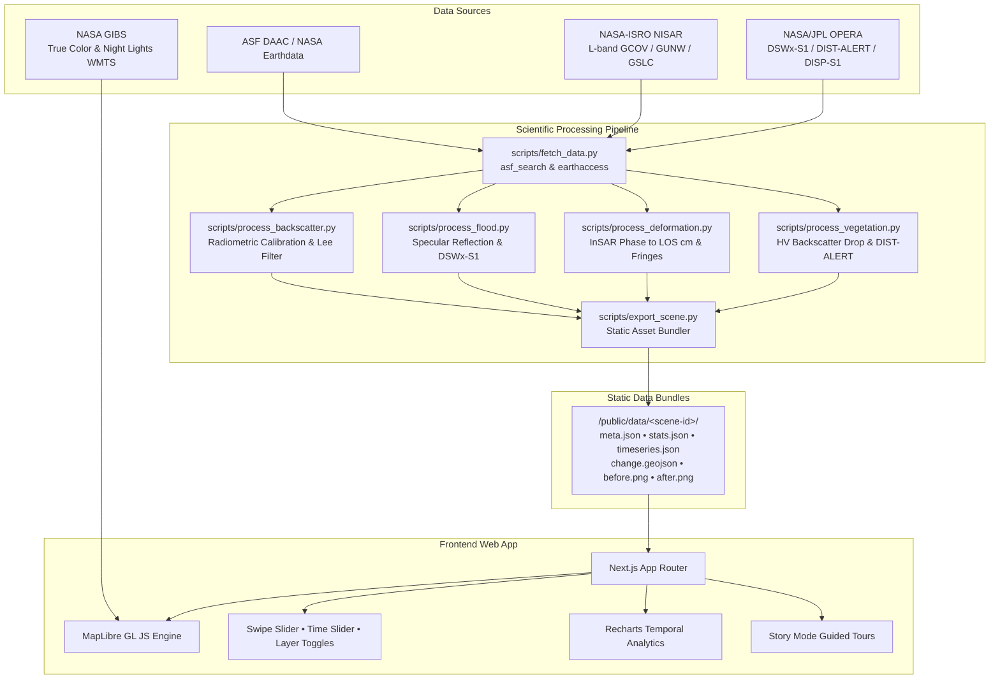

# Project Liquid — System Architecture

### NASA Space Apps Challenge 2026: "Dancing with the SARs"

Project Liquid is an interactive, mobile-first web application designed to track and visualize dynamic Earth-surface change using NASA-ISRO NISAR and NASA OPERA Synthetic Aperture Radar (SAR) products.

---

## High-Level Architecture Overview

---

## 1. Offline Scientific Radar Processing (`/scripts`)

The offline processing pipeline guarantees zero dependency on live data downloads or external API credentials during public demonstrations:

1. **`fetch_data.py`:**
   - Interfaces with ASF DAAC and NASA Earthdata using `asf_search` and `earthaccess`.
   - Authenticates via Earthdata Login credentials (`NASA_EARTHDATA_USER`, `NASA_EARTHDATA_PASS`).
   - Falls back gracefully to curated local sample assets if network or credentials are unavailable.

2. **`process_backscatter.py`:**
   - Calibrates raw SAR digital numbers (DN) to decibels:
     $$\sigma^0_{\text{dB}} = 10 \cdot \log_{10}(\text{amplitude}^2 + \epsilon) - K$$
   - Executes enhanced Lee speckle filtering to remove noise while preserving structural edges.
   - Computes multi-temporal log-ratio change masks ($\Delta\text{dB} = \sigma^0_{\text{after}} - \sigma^0_{\text{before}}$).

3. **`process_flood.py`:**
   - Detects specular reflection attenuation on open standing water ($\sigma^0 < -16.5\text{ dB}$).
   - Derives flooded area delta and exports vectorized polygons with $km^2$ extent metrics.

4. **`process_deformation.py`:**
   - Converts unwrapped InSAR interferogram phase ($\Delta\phi$) into Line-of-Sight (LOS) displacement in centimeters:
     $$d_{\text{LOS}} = -\frac{\lambda}{4\pi} \Delta\phi$$
     *(where $\lambda = 24\text{ cm}$ for NISAR L-band)*.
   - Produces continuous deformation color gradients and cyclical $2\pi$ wrapped fringe modes.

5. **`process_vegetation.py`:**
   - Identifies canopy loss from cross-polarized HV backscatter collapse (depolarizing volume scattering reduction).
   - Ingests OPERA DIST-ALERT disturbance alerts.

6. **`export_scene.py`:**
   - Packages normalized static scene directories into `/public/data/<scene-id>/` containing `meta.json`, `stats.json`, `timeseries.json`, `change.geojson`, `before.png`, and `after.png`.

---

## 2. Frontend Web Application

- **Next.js 14 App Router:** Server-side rendered shell with client-side WebGL canvas hydration.
- **MapLibre GL JS:** High-performance hardware-accelerated mapping engine supporting image raster sources and GeoJSON vector layers.
- **NASA GIBS Tile Integration:** Seamless WMTS raster tile switching between NASA GIBS MODIS/VIIRS True Color, NASA Black Marble Night Lights, and Dark Radar basemaps.
- **Dual Visual Inspection Modes:**
  - Dynamic Before/After swipe slider divider.
  - Multi-temporal time slider with auto-play animation.
- **Guided Story Mode:** Programmatic camera flights (`map.flyTo`) coupled to narrative caption cards.
- **Export & Share:** Instant GeoJSON download and shareable plain-hash URLs (`#scene-id`).
- **Accessible & Mobile-First:** Responsive layout down to 360px viewport width, high-contrast dark theme, and prefers-reduced-motion support.

---

## 3. Data Integrity & Verification
Every scene in Project Liquid reflects verified NASA specifications:
- Exact geographic bounding boxes and coordinate centers.
- Actual NASA OPERA and NISAR product identifiers.
- Clear data flags (`"real"` or `"sample"`).
- Plain attribution credit: *"Data: NASA-ISRO NISAR, NASA/JPL OPERA, ASF DAAC, NASA GIBS"*.
